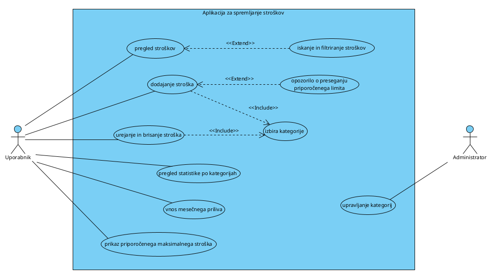

# Aplikacija za spremljanje stroškov

Projekt pri predmetu razvoj informacijskih sistemov. Gre za preprosto spletno aplikacijo, kjer si lahko zapisuješ svoje stroške (npr. kava, najemnina, bencin) in jih razvrstiš po kategorijah.

## O projektu

Ideja je, da imaš na enem mestu pregled, na kaj zapravljaš denar.

Kaj aplikacija dela:
- dodajanje novega stroška (naziv, znesek, datum, čas, kategorija, način plačila, opis),
- urejanje in brisanje stroškov,
- prikaz stroškov po straneh, najnovejši so na vrhu,
- filtriranje po kategoriji (filter po glavni kategoriji pokaže tudi stroške njenih podkategorij),
- iskanje po nazivu

Aplikacija ima tri dele: frontend (kar vidi uporabnik), backend (REST API) in bazo.

## Diagram primerov uporabe (DPU)

Diagram prikazuje ključne funkcionalnosti v načrtovani različici aplikacije.



**Že implementirane funkcionalnosti:**\
PU1: pregled stroškov\
PU2: iskanje in filtriranje stroškov\
PU3: dodajanje stroška\
PU4: urejanje in brisanje stroška\
PU5: izbira kategorije\

**Načrtovane funkcionalnosti:**\
PU6: pregled statistike po kategorijah\
PU7: vnos mesečnega  priliva\
PU8: opozorilo o preseganju priporočenega limita\
PU9: prikaz priporočenega maksimalnega stroška\
PU10: upravljanje kategorij

Akterja:
- Uporabnik, ki upravlja stroške in mesečni priliv ter vidi priporočeni limit
- Administrator, ki upravlja kategorije

Povezave:
- `<<include>>`: dodajanje (PU3) in urejanje stroška (PU4) vedno vklučujeta izbiro kategorije (PU5)
- `<<extend>>`: iskanje in filtriranje (PU2) razširja pregled stroškov (PU1), opozorilo o preseganju priporočenega limita (PU8), vendar samo če strošek preseže dnevni ali mesečni limit

## Uporabljene tehnologije
Backend:
- Java 21
- Spring Boot 3.2.5 (Spring Web, Spring Data JPA, Validation)
- Postgres: 16
- Swagger (springdoc-openapi 2.2.0)
- Maven 3.9.16 (prek Maven Wrapperja 3.3.4; Mavena ni treba namestiti posebej)

Frontend:
- React 19.3
- Vite 8.3
- Bootstrap 5.3
- ESLint 10.13

Baza in orodja:
- PostgreSQL 16 (teče v Dockerju)
- Docker Desktop
- Node.js 22 ali novejši
- VS Code in DataGrip

## Struktura projekta
```
.
├── backend/                                # Spring Boot aplikacija
│   ├── src/main/java/com/example/backend/
│   │   ├── BackendApplication.java         # zažene aplikacijo
│   │   ├── controller/                     # kontrolerji z endpointi
│   │   │   ├── KontrolerStrosek.java       # dodajanje, branje, urejanje, brisanje stroškov
│   │   │   └── KontrolerKategorija.java    # vrne seznam kategorij
│   │   ├── entitete/                       # entitete (tabele) in dostop do baze
│   │   │   ├── Strosek.java                # tabela Strosek
│   │   │   ├── Kategorija.java             # tabela Kategorija
│   │   │   ├── StrosekBaza.java            # JpaRepository + findByKategorija
│   │   │   └── KategorijaBaza.java         # JpaRepository
│   │   └── config/
│   │       └── CorsConfig.java             # dovoli, da frontend kliče backend
│   ├── src/main/resources/
│   │   └── application.properties          # povezava na bazo in Swagger
│   └── pom.xml                             # knjižnice backenda
├── frontend/                               # React aplikacija
│   ├── src/
│   │   ├── App.jsx                         # glavna komponenta (tabela, obrazec, filtri, strani)
│   │   ├── Header.jsx                      # glava strani
│   │   ├── main.jsx                        # vstopna točka
│   │   └── index.css                       # stili
│   └── package.json                        # knjižnice frontenda
├── baza/baza-setup/
│   ├── docker-compose.yml                  # zažene PostgreSQL v Dockerju
│   └── praktikum_baza.sql                  # ustvari tabeli in vstavi testne podatke
├── dokumentacija/                          # poročila vaj in screenshoti
└── .env.example                            # predloga za okoljske spremenljivke (podatki za bazo)
```

**Opombe:**
- `StrosekBaza` in `KategorijaBaza` dedujeta od `JpaRepository`, zato že imata osnovne metode (`findAll`, `findById`, `save`, `deleteById`). `StrosekBaza` ima še `findByKategorija`, ki vrne samo stroške izbrane kategorije.
- `praktikum_baza.sql` je samo ime datoteke. S praktikumom nima zveze, ima le podobno konfiguracijo.

Kje so pomembne stvari:
- endpointi so v mapi backend/.../controller
- uporabnik, geslo in ime baze so v datoteki .env (ta ni v gitu), application.properties jih samo prebere
- klici na backend so v frontend/src/zaledje.js
- tabele in testni podatki so v praktikum_baza.sql

## Navodila za nameščanje in zagon

### Predpogoji

Na računalniku moraš imeti nameščeno:
- Git,
- Javo (JDK 21 ali novejšo),
- Node.js 22 ali novejši (zraven pride tudi npm) naložimo v mapo frontend,
- Docker Desktop,
- po želji DataGrip za pregled baze

### 1. Prenos projekta
*git clone https://github.com/frozozone/Aplikacija-za-spremljanje-stro-kov.git*

*cd Aplikacija-za-spremljanje-stro-kov*

### 2. Okoljske spremenljivke

Uporabnik in geslo za bazo nista v gitu, ker ne spadata v javni repozitorij. Namesto tega so v datoteki .env v korenu projekta, ki jo moraš ustvariti sam.

V korenu projekta skopiraj predlogo:

*copy .env.example .env*

Nato odpri .env in vpiši svoje podatke, npr.:
- POSTGRES_USER=admin
- POSTGRES_PASSWORD=tvoje_geslo
- POSTGRES_DB=praktikum_baza

To datoteko uporabljata oba, Docker (ko ustvari bazo) in backend (ko se poveže na bazo), zato podatke vpišeš samo enkrat.

Poleg tega **mora biti** nastavljena sistemska spremenljivka JAVA_HOME, ki kaže na mapo, kjer je nameščena Java (npr. C:\Program Files\Java\jdk-21). Brez nje mvnw ne deluje. Preveriš jo z ukazom:

*echo %JAVA_HOME%*

### 3. Zagon baze
Docker Desktop mora biti prižgan. V mapi baza/baza-setup poženi:

*docker compose up -d*

Ob prvem zagonu se samodejno ustvarijo tabele in testni podatki. Z ukazom *docker ps* preveriš, ali container "praktikum" teče (status mora biti Up).

Za povezavo na bazo (npr. v DataGripu) uporabiš host localhost, port 5432 ter ime baze, uporabnika in geslo iz .env.

Če imaš na portu 5432 že kakšno drugo bazo, jo najprej ustavi.

Skripta praktikum_baza.sql se izvede samo, ko se container ustvari prvič. Če se skripta spremeni (npr. nove tabele), moraš container in njegove podatke pobrisati in ga ustvariti znova (vsi podatki v bazi se izgubijo):

*docker compose down -v*

*docker compose up -d*

Testni uporabniki v bazi (vsi imajo geslo *geslo123*, shranjeno kot bcrypt hash; prijave v aplikaciji še ni):
- admin - vloga Administrator (zaenkrat nima dodatnih pravic)
- ana - večina testnih stroškov
- marko - nekaj stroškov

Dokler prijava ni narejena, aplikacija prikaže stroške vseh uporabnikov, nove stroške pa shrani uporabniku, ki je nastavljen v application.properties (aplikacija.privzeti-uporabnik, privzeto ana).

### 4. Zagon backenda

V novem terminalu pojdi v mapo backend in poženi:

*mvnw spring-boot:run*

ALI

*mvn spring-boot:run* če imaš ustrezni Maven naložen

(Ukazi v teh navodilih so za cmd. Če uporabljaš PowerShell, npr. terminal v VS Code, je isto samo z drugo sintakso recimo: *.\mvnw spring-boot:run*.)

Backend teče na http://localhost:8080, seznam vseh endpointov pa je v Swaggerju na http://localhost:8080/swagger-ui.html

### 5. Zagon frontenda

V novem terminalu pojdi v mapo frontend in poženi:

*npm install* (če še nimaš) za node modules

*npm run dev*

Ukaz npm install je treba pognati samo prvič. Aplikacijo nato odpreš v brskalniku na **http://localhost:5173**

Vrstni red zagona je pomemben: najprej baza, nato backend, na koncu frontend.

## Navodila za razvijalce

### Veje

V veji main je vedno koda, ki deluje. Za vsako novo stvar naredimo svojo vejo:
- feature/ime - nova funkcionalnost, npr. feature/filter-po-datumu
- hotfix/ime - popravek napake, npr. hotfix/brisanje-stroska

### Potek dela

1. Pred začetkom dela poberi najnovejšo verzijo:

   *git pull*

2. Naredi novo vejo in se prestavi vanjo:

   *git checkout -b feature/ime-funkcionalnosti*

3. Ko končaš s spremembami:

   *git status*

   *git add .*

   *git commit -m "feat: kratek opis"*

   *git push origin feature/ime-funkcionalnosti*

4. Ko vse deluje, vejo združiš v main (na GitHubu odpreš Pull Request ali pa lokalno):

   *git checkout main*

   *git merge feature/ime-funkcionalnosti*

   *git push*

### Commit sporočila

Prva vrstica naj bo kratka (do približno 50 znakov) in naj se začne s tipom spremembe:
- feat: nova funkcionalnost, npr. "feat: dodano filtriranje po kategoriji"
- fix: popravek napake, npr. "fix: brisanje stroška ne osveži tabele"
- docs: spremembe v dokumentaciji, npr. "docs: posodobljen README"
- refactor: preurejena koda, ki ne spremeni delovanja

### Nekaj pravil

- pred pushom preveri, da se projekt zažene (vsi trije terminali morajo delati)
- en commit naj bo ena smiselna sprememba, raje več manjših kot en ogromen
- ne pushaj datotek, ki so v .gitignore (node_modules, target, dist, .env, Word dokumenti in druge stvari, ki niso potrebne za projekt)
- gesel in drugih skrivnosti nikoli ne pišemo v kodo, ampak v .env

## Standardi kodiranja

- imena spremenljivk, metod in razredov so v slovenščini in smiselno in intuitivno poimenovane, npr. dodajStrosek, izbranaKategorija in brez okrajšav recimo dodStros namesto dodajStrosek
- če koda ni takoj jasna in intuitivna, je zraven kratek komentar, ki opiše delovanje drugače pa samo informativni komentar nad blokom kode (nepotrebni komentar ki opisuje to kar nam že pove sintaksa je odveč)
- če si nek velik blok kode mergal na main vejo ali pa pač delaš na njem, zapiši kdaj je bil merge izveden, in kdo ga je izvedel, ter kdo je kodo pisal recimo ```//Merge 11.9.2026 Omar, feat: Filtriranje stroška po kategoriji"```
- datoteka ni daljša od 400 vrstic
- uporablja se camelCase poimenovanje recimo "dodajStrosek" (če sintaksa tega ne dovoli pa PascalCase recimo "DodajStrosek" namesto "dodajStrosek"
- funkcije so čim krajše in čim enostavnejše, morajo opravljiti eno funkcijo, če je možno funkcijo razbiti na več delov, potem pišeš več funkcij
- imena datotek so smiselna in intuitivna
- preden se nadaljuje z razvojem je treba kodo ki je bila napisana stestirati, najlažje skozi Swagger, potem v datagripu ali kje drugje pogledati kako se baza obnaša in na koncu še ročno se postaviti v scenarij in feature stestirati v čim več možnih situacijah.
- Pisanje SQL stavkov ali sintakse z velikimi črkami recimo: "SELECT * FROM strosek" namesto "select * from strosek"
- Komentari za to do recimo "TODO: Popravi izgled forma za dodajanje stroška"
- če je le možno se držimo exception handlinga torej try-catch stavkov, veliko krat boljše kot pa recimo ugnezdeni if stavki (enako stvar dosežemo z bolj pregledno kodo)
