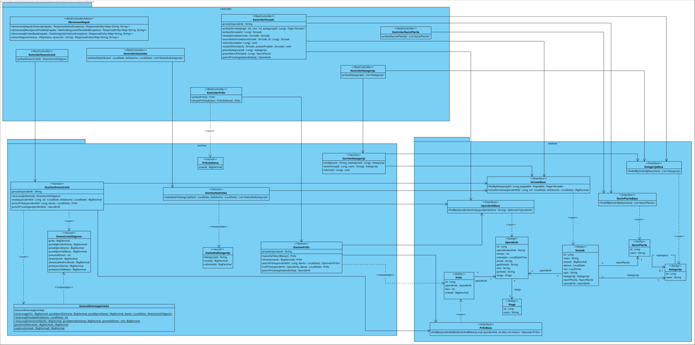

# Razredni diagram

[Diagram v polni velikosti](Razredni-diagram/Class_Diagram.svg)

#### Še ni implementirano
- `StoritevStatistika`, `KontrolerStatistika` in `StatistikaKategorije` (PU6)
- `StoritevKategorija` (PU10)

## Opis razredov:
Aplikacija je slojevita: kontroler, storitev, repozitorij, entiteta.

### Entitete:
- `Uporabnik`: uporabnik aplikacije (uporabniško ime, e-pošta, geslo, ime, priimek, vloga). Je lastnik stroškov in priliva. Dokler ni prijave, se uporablja privzeti uporabnik.
- `Vloga`: vloga uporabnika, vsak uporabnik ima eno.
- `Kategorija`: kategorija stroška; ima lahko nadrejeno kategorijo(0..1), kar omogoča podkategorije.
- `NacinPlacila`: šifrant načinov plačila (gotovina, kartica...)
- `Strosek`: en vnos porabe: naziv, znesek, datum, čas, opis, kategorija, način plačila, uporabnik.
- `Priliv`: mesečni priliv uporabnika (leto, mesec, znesek), osnova za izračun dnevnega limita.

### Repozitoriji:
Vsi razširjajo JpaRepository, ki že vsebuje osnovne operacije (findAll, findById, save, deleteById), zato so v diagramu prikazane le dodatne metode.
- `UporabnikBaza`: dostop do uporabnikov, `findByUporabniskoIme` poišče uporabnika (privzetega).
- `StrosekBaza`: dostop do stroškov, `findByKategorija` vrne stroške izbrane kategorije in njenih podkategorij, `vsotaStroskov` vrne vsoto stroškov uporabnika med dvema datumoma.
- `KategorijaBaza`, `NacinPlacilaBaza`: `findAllByOrderByNazivAsc` vrne šifrant po abecedi.
- `PrilivBaza`: `findByUporabnikIdAndLetoAndMesec` poišče priliv za izbran mesec.

### Storitve:
- `StoritevDnevniLimit`: iz baze zbere priliv in porabo ter ju preda izračunu, sama ne računa.
- `IzracunDnevnegaLimita`: pomožni razred s statičnimi metodami. Izračun je ločen od baze, zato ga je lahko testirati.
- `StoritevPriliv`: poišče priliv za tekoči mesec ter ga ustvari ali posodobi.
- `StoritevKategorija`(načrtovano): dodajanje, preimenovanje in brisanje kategorij.
- `StoritevStatistika`(načrtovano): statistika porabe po kategorijah za izbrano obdobje.

### Kontrolerji:
Kontrolerji sprejmejo zahtevo s frontenda in jo predajo storitvi oz. repozitoriju.
- `KontrolerStrosek`: endpointi za stroške. `prikaziStroske` vrne stroške po straneh (PU1), opcijsko filtrirane po kategoriji in njenih podkategorijah (PU2; iskanje po nazivu je na frontendu). `prikaziStrosek` vrne en strošek ali 404. `dodajStrosek` in `izbrisiStrosek` (PU4) ter `posodobiStrosek` (PU3) urejajo stroške. Zasebna metoda `nastaviSifrante` id-ja kategorije in načina plačila zamenja z zapisoma iz baze oz. vrne 400, če ne obstajata (PU5).
- `KontrolerKategorija`, `KontrolerNacinPlacila`: `prikaziKategorije` in `prikaziNacinePlacila` vrneta šifrant po abecedi za izbiro v obrazcu (PU5).
- `KontrolerDnevniLimit`: `prikaziDnevniLimit` vrne današnji dnevni limit (PU9) ali 404, če priliv še ni vnesen. Iz odgovora frontend izračuna opozorilo o preseganju limita (PU8).
- `KontrolerPriliv`: `prikaziPriliv` in `shraniPriliv` za mesečni priliv (PU7).
- `KontrolerStatistika`(načrtovano): vrne statistiko po kategorijah.
- `ObravnavaNapak`: napake iz vseh kontrolerjev (ResponseStatusException, neveljavni podatki, kršitve baze) vrne v obliki `{"message": "..."}`.

### record:
- `DnevniLimitOdgovor`: rezultat izračuna dnevnega limita, ki ga prejme frontend (priliv, poraba do včeraj/danes/ta mesec, preostali dnevi, limit, preseženi zneski).
- `PrilivZahteva`: telo zahteve za vnos priliva (znesek, obvezen in večji od 0).
- `StatistikaKategorije`(načrtovano): ena vrstica statistike: kategorija, vsota in odstotek.

## Ključne metode in potek funkcionalnosti:
- `StoritevDnevniLimit.izracunajZaDanes`: iz baze zbere priliv ter porabo do včeraj in danes, nato pokliče `IzracunDnevnegaLimita.izracunaj`, ki izračuna limit = (priliv − porabljeno do včeraj) / preostali dnevi (vključno z današnjim), zaokroženo navzdol na 2 decimalki; če je priliv že porabljen, je limit 0.
- `StoritevPriliv.shrani`: ustvari ali posodobi priliv za tekoči mesec.
- `StrosekBaza.findByKategorija` in `vsotaStroskov`: filtriranje stroškov po kategoriji in vsota porabe za izračun limita.
- `KontrolerStrosek.pridobi, dodaj, posodobi in izbrisi`: pregled, iskanje ter dodajanje, urejanje in brisanje stroškov; pred shranjevanjem današnjega stroška odjemalec prek `KontrolerDnevniLimit` preveri prekoračitev dnevnega limita (PU8).
- `KategorijaBaza` in `NacinPlacilaBaza` (`findAllByOrderByNazivAsc`): pridobi urejenega šifranta kategorij in načinov plačila za izbiro pri vnosu ali urejanju stroška.
- `StoritevStatistika.izracunajZaObdobje`: za izbrano obdobje zbere stroške uporabnika, jih združi po kategorijah ter izračuna skupne zneske in odstotne deleže porabe v zapisu `StatistikaKategorije`.
- `StoritevKategorija.dodaj, preimenuj in izbrisi`: upravljanje kategorij in podkategorij; pred dodajanjem ali preimenovanjem preveri, da je ime novo, pred brisanjem pa prek `StrosekBaza.findByKategorija` prekliče izbris, če so na kategorijo že vezani stroški.
- `ObravnavaNapak`: prestreže izjeme iz kontrolerjev in storitev (neveljaven znesek, manjkajoč priliv, ...), ter vrne ustrezno sporočilo o napaki.
